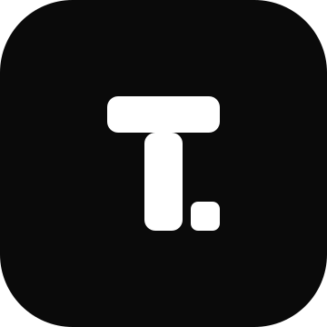

<p align="center">
  <a href="./README.md">简体中文</a> · <strong>English</strong>
</p>

<p align="center">
  <picture>
    <source media="(prefers-color-scheme: dark)" srcset="apps/web/public/logo-dark.svg" />
    
  </picture>
</p>

<h1 align="center">Token Usage</h1>

<p align="center">
  Self-hosted AI token usage tracking: one account, many machines,<br />
  all usage and cost data stored in <strong>your own Supabase</strong>.
</p>

<p align="center">
  <a href="https://github.com/baiwumm/token-usage/actions/workflows/ci.yml"></a>
  <a href="https://token-usage.cc"></a>
  <a href="./LICENSE"></a>
</p>

<p align="center">
  
  
  
  
  
  
</p>

<p align="center">
  🌐 <a href="https://token-usage.cc">Website</a> ·
  📖 <a href="docs/cli-contract.md">API contract</a> ·
  🚀 <a href="docs/deploy-guide.md">Deploy guide</a> ·
  🤖 <a href="AGENTS.md">Agent rules</a>
</p>

## ✨ Features

- **One account, many machines** — every collector pairs and revokes independently; usage aggregates per account and drills down per device
- **Metadata only** — the collector parses local AI tool logs into a local queue; prompts, message bodies, absolute paths and session titles are never collected
- **Full dashboard** — KPIs, trends, activity heatmap, model / source / device breakdowns, daily·hourly·monthly tables, cost analysis, session details, project attribution, collector run history, yearly wrapped, and a 20 × 5 achievement wall
- **Vendor credits** — tracked as a separate dimension, never mixed into tokens or cost
- **Public badge** — `/api/badge` renders a deterministic SVG; `/u/<token>` is a public usage page with no login required, revocable at any time
- **Data ownership** — each instance binds its own Supabase project; nothing is shared across instances, and browsers never read data tables directly (RLS denies everything + service-role)
- **Contract first** — the collector-facing API is frozen, the dashboard API evolves with the UI ([`docs/cli-contract.md`](docs/cli-contract.md))
- **Multiple surfaces** — web dashboard, collector CLI (npm `tokenusage-cli`), marketing site, and a Tauri 2 tray companion

## 🧱 Stack

| Surface | Path | Stack |
| --- | --- | --- |
| Web | [`apps/web`](apps/web) | Next.js 16 App Router + React 19 + HeroUI 3 + Tailwind CSS 4 + recharts |
| Collector CLI | [`packages/cli`](packages/cli) | Node.js ≥ 22.19, npm `tokenusage-cli` |
| Site | [`apps/landing`](apps/landing) | Next.js 16 static export (single-page site) |
| Desktop | [`apps/desktop`](apps/desktop) | Tauri 2 + React 19 + HeroUI 3 (tray companion) |
| Data | `supabase/` | Supabase Auth + Postgres, migrations applied in filename order |

## 🚀 Quick start

Prerequisites: Node.js ≥ 22.19, pnpm (version pinned by the root `packageManager`), and a Supabase project.

```bash
pnpm install
cp apps/web/.env.example apps/web/.env.local   # Supabase URL / publishable key / secret key
pnpm dev                                       # http://localhost:3000
```

### 🤖 Let an agent deploy it

Everything from "empty Supabase project" to "collector reporting" is documented as an
agent-executable runbook. Paste this into your coding agent:

```text
Deploy this repository's Token Usage app from scratch, following docs/deploy-guide.md
section by section, and report the result of each section:

1. Create a Supabase project; write Project URL / publishable key / secret key into
   apps/web/.env.local (never commit them).
2. Apply every migration in supabase/migrations/ in filename order (idempotent); confirm
   the token_* tables exist and no RLS policies were added.
3. Configure Supabase Auth: Site URL plus wildcard Redirect URLs (https://<domain>/**),
   and disable public sign-ups.
4. Deploy apps/web to Vercel with the four required environment variables.
5. Create the admin account with scripts/admin/create-user.cjs.
6. Pair a collector: tokenusage device-login → approve on /device → tokenusage sync --drain.
7. Run the smoke checklist in docs/launch-runbook.md and print the actual output of each step.

Stop and ask me before any irreversible action (deleting a project, switching domains);
keep secrets local and never echo them.
```

The agent's two sources of truth: [`docs/deploy-guide.md`](docs/deploy-guide.md) (from
zero, including env vars and FAQ) and [`docs/launch-runbook.md`](docs/launch-runbook.md)
(upgrades, smoke checks, rollback).

## 📚 Documentation

Project documentation is written in Chinese. Start with [`AGENTS.md`](AGENTS.md) for
conventions, [`docs/requirements.md`](docs/requirements.md) for scope,
[`docs/rewrite-plan.md`](docs/rewrite-plan.md) for architecture, and
[`docs/cli-contract.md`](docs/cli-contract.md) for the API contract.

## ⚖️ License

[MIT](./LICENSE). Code provenance and third-party licenses live in
[`THIRD_PARTY_NOTICES.md`](./THIRD_PARTY_NOTICES.md) and
[`packages/cli/THIRD_PARTY_NOTICES.md`](./packages/cli/THIRD_PARTY_NOTICES.md).
