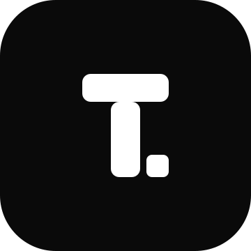
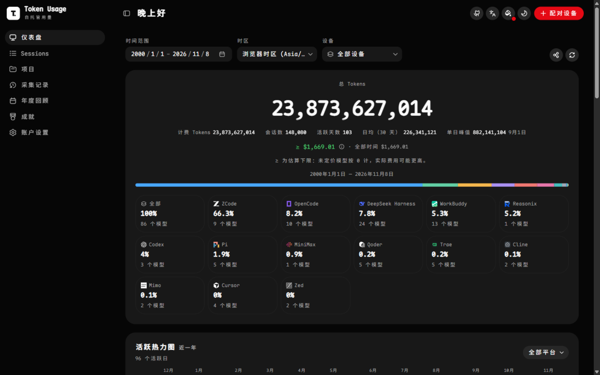

<p align="center">
  <strong>English</strong> · <a href="./README.zh-CN.md">简体中文</a>
</p>

<p align="center">
  <picture>
    <source media="(prefers-color-scheme: dark)" srcset="apps/web/public/logo-dark.svg" />
    
  </picture>
</p>

<h1 align="center">Token Usage</h1>

<p align="center">
  Self-hosted AI token usage tracker for Claude Code, Codex, Cursor and 40+ other coding tools:<br />
  one account, many machines, every token and every dollar stored in <strong>your own Supabase</strong>.
</p>

<p align="center">
  <a href="https://github.com/baiwumm/token-usage/actions/workflows/ci.yml"></a>
  <a href="https://www.token-usage.cc"></a>
  <a href="./LICENSE"></a>
  <a href="docs/requirements.md"></a>
  <a href="https://www.npmjs.com/package/tokenusage-cli"></a>
</p>

<p align="center">
  
  
  
  
  
  
  
</p>

<p align="center">
  🌐 <a href="https://www.token-usage.cc">Website</a> ·
  🖥️ <a href="https://demo.token-usage.cc">Live demo</a> ·
  📖 <a href="https://www.token-usage.cc/docs/">Docs</a> ·
  🚀 <a href="https://www.token-usage.cc/docs/start/">Deploy guide</a> ·
  🤖 <a href="AGENTS.md">Agent rules</a>
</p>

<p align="center">
  <a href="https://app.token-usage.cc/u/tu_page_bOlbNTnYObADlBpAbskviq2h66gHzoGL">
    
  </a>
  <br />
  <sub>Live usage of the author's instance — rendered by this project's <a href="docs/badge.md">public badge</a>, click through to the public page</sub>
</p>

<p align="center">
  
</p>

## ✨ Features

- **One account, many machines** — every collector pairs and revokes independently; usage aggregates per account and drills down per device
- **Metadata only** — the collector parses local AI tool logs into a local queue; prompts, message bodies, absolute paths and session titles are never collected
- **Full dashboard** — KPIs, trends, activity heatmap, model / source / device breakdowns, daily·hourly·monthly tables, cost analysis, session details, project attribution, collector run history, yearly wrapped, and a 20 × 5 achievement wall
- **Vendor credits** — tracked as a separate dimension, never mixed into tokens or cost
- **Public badge** — `/api/badge` renders a deterministic SVG; `/u/<token>` is a public usage page with no login required, revocable at any time
- **Data ownership** — each instance binds its own Supabase project; nothing is shared across instances, and browsers never read data tables directly (RLS denies everything + service-role)
- **Contract first** — the collector-facing API is frozen, the dashboard API evolves with the UI ([`docs/cli-contract.md`](docs/cli-contract.md))
- **Multiple surfaces** — web dashboard, collector CLI (npm `tokenusage-cli`), marketing site, and a Tauri 2 tray companion

## 🔍 How it compares

Token Usage reads the logs your AI tools already write on disk. No proxy, no SDK, no code
changes, and nothing leaves your machine except aggregate counts for the instance you paired.

| | Token Usage | Local report CLIs (e.g. ccusage) | Hosted LLM observability (e.g. Helicone, Langfuse) |
| --- | --- | --- | --- |
| How data is collected | Parses local tool logs on a schedule | Parses local logs on demand | Traffic routed through a proxy or instrumented with an SDK |
| Changes to your AI tools | None | None | Proxy URL or SDK integration |
| Persistent storage | Your own Supabase | Local files / terminal output | Vendor cloud, or self-hosted |
| Multi-machine, one account | Yes | No | Usually per deployment, not per machine |
| Dashboard UI | Yes, self-hosted | No | Yes |
| Built for | Personal and small-team usage accounting | Quick ad-hoc reports | Request-level tracing, latency and evals |

These tools solve different problems and can be used together: observability platforms tell
you what a request cost and why it was slow; Token Usage tells you what your editors and CLI
agents consumed across all your machines over time, and keeps that history in a database you
control.

## 🧱 Stack

| Surface | Path | Stack |
| --- | --- | --- |
| Web | [`apps/web`](apps/web) | Next.js 16 App Router + React 19 + HeroUI 3 + Tailwind CSS 4 + recharts |
| Collector CLI | [`packages/cli`](packages/cli) | Node.js ≥ 22.19, npm `tokenusage-cli` |
| Site | [`apps/landing`](apps/landing) | Next.js 16 static export (single-page site) |
| Desktop | [`apps/desktop`](apps/desktop) | Tauri 2 + React 19 + HeroUI 3 (tray companion) |
| Data | `supabase/` | Supabase Auth + Postgres, migrations applied in filename order |

## 📁 Project layout

```text
token-usage/
├── apps/
│   ├── web/          # dashboard + collector contract endpoints
│   ├── landing/      # token-usage.cc marketing site (static export)
│   └── desktop/      # Tauri 2 tray companion
├── packages/cli/     # collector CLI (npm: tokenusage-cli)
├── supabase/         # Postgres migrations (timestamp order, idempotent)
├── scripts/          # ops scripts (index in scripts/README.md)
├── docs/             # requirements, contracts, UI spec, deploy and runbooks
├── AGENTS.md         # development conventions and agent constraints
└── THIRD_PARTY_NOTICES.md
```

## 🚀 Quick start

Prerequisites: Node.js ≥ 22.19, pnpm (version pinned by the root `packageManager`), and a Supabase project.

```bash
pnpm install
cp apps/web/.env.example apps/web/.env.local   # Supabase URL / publishable key / secret key
pnpm dev                                       # http://localhost:3000
```

### 🧑‍💻 Collector CLI

```bash
npm install -g tokenusage-cli
tokenusage init          # scan local AI tool logs, install the usage hook, register the hourly task
tokenusage device-login  # print a pairing code, approve it in the browser at /device
tokenusage sync          # report once; --watch keeps it resident
```

Logs are read-only and only usage metadata leaves the machine (never prompts, message
bodies, absolute paths or session titles). Full command surface and source support live in
[`packages/cli/README.md`](packages/cli/README.md).

### 🤖 Let an agent deploy it

Everything from "empty Supabase project" to "collector reporting" is documented as an
agent-executable runbook. Paste this into your coding agent:

```text
Deploy this repository's Token Usage app from scratch, following docs/deploy-guide.md
section by section, and report the result of each section:

1. Create a Supabase project; write Project URL / publishable key / secret key into
   apps/web/.env.local (never commit them).
2. Apply every migration in supabase/migrations/ in filename order (idempotent); confirm
   the token_* tables exist and no RLS policies were added.
3. Configure Supabase Auth: Site URL plus wildcard Redirect URLs (https://<domain>/**),
   and disable public sign-ups.
4. Deploy apps/web to Vercel with the four required environment variables.
5. Create the admin account with scripts/admin/create-user.cjs.
6. Pair a collector: tokenusage device-login → approve on /device → tokenusage sync --drain.
7. Run the smoke checklist in docs/launch-runbook.md and print the actual output of each step.

Stop and ask me before any irreversible action (deleting a project, switching domains);
keep secrets local and never echo them.
```

The agent's two sources of truth: [`docs/deploy-guide.md`](docs/deploy-guide.md) (from
zero, including env vars and FAQ) and [`docs/launch-runbook.md`](docs/launch-runbook.md)
(upgrades, smoke checks, rollback). Or hit the button below and fill in the env vars after
the deploy:

<p align="center">
  <a href="https://vercel.com/new/clone?repository-url=https%3A%2F%2Fgithub.com%2Fbaiwumm%2Ftoken-usage&project-name=token-usage&repository-name=token-usage">
    
  </a>
</p>

## ❓ FAQ

### Does it collect my prompts or conversation content?

No. The collector only sends aggregate token counts, model names, project basenames and
session metadata (start/end time, token split, per-model usage). Prompts, assistant
messages, tool arguments, command output, diffs, session titles and absolute paths are
never uploaded. The boundary is locked by a field whitelist in `packages/cli/test/`.

### Which AI coding tools are supported?

46 local sources plus 5 account-level sources, including Claude Code, Codex, Cursor,
GitHub Copilot, Gemini, Qoder, Kiro, Zed, TRAE and more. The authoritative list is
`tokenusage sync --help`; only tools you actually use are scanned.

### Do I need to change my tools or route requests through a proxy?

No. Token Usage reads the logs those tools already write to disk. Nothing changes in your
editor, CLI or API calls.

### Do I need a server?

You need a Supabase project and the web app running somewhere — Vercel or your own host.
It can also run locally if you only want the dashboard on your own machine.

### How is this different from a local usage-report CLI?

A CLI report reads the logs, prints numbers and exits. Token Usage keeps the data in your
Supabase, aggregates multiple machines under one account, shows trends and project
attribution over time, and can publish a badge or a login-free public page.

### Is my data sent anywhere else?

Only to the instance you paired. The CLI sends no anonymous telemetry and no third-party
error reports; apart from your own instance, nothing receives data.

## 📚 Documentation

Product documentation lives at [www.token-usage.cc/docs](https://www.token-usage.cc/docs/).
Repository documentation is written in Chinese: start with [`AGENTS.md`](AGENTS.md) for
conventions, [`docs/requirements.md`](docs/requirements.md) for scope,
[`docs/rewrite-plan.md`](docs/rewrite-plan.md) for architecture, and
[`docs/cli-contract.md`](docs/cli-contract.md) for the API contract.

| Document | Content |
| --- | --- |
| [`docs/deploy-guide.md`](docs/deploy-guide.md) | Deploy from zero (Supabase + Vercel) |
| [`docs/launch-runbook.md`](docs/launch-runbook.md) | Upgrades, smoke checklist, rollback |
| [`docs/cli-contract.md`](docs/cli-contract.md) | Collector API contract |
| [`docs/badge.md`](docs/badge.md) | Public badge and public page |
| [`docs/sources-capture-audit.md`](docs/sources-capture-audit.md) | How each source is captured |
| [`packages/cli/README.md`](packages/cli/README.md) | Collector install, commands, troubleshooting |
| [`docs/archive/`](docs/archive/) | Historical records |

## ⚖️ License

[MIT](./LICENSE). Code provenance and third-party licenses live in
[`THIRD_PARTY_NOTICES.md`](./THIRD_PARTY_NOTICES.md) and
[`packages/cli/THIRD_PARTY_NOTICES.md`](./packages/cli/THIRD_PARTY_NOTICES.md).
