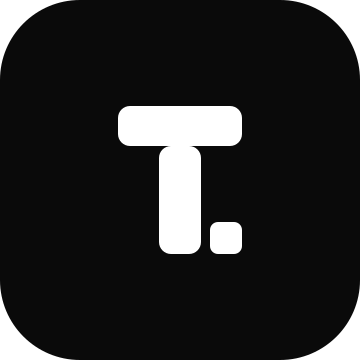

<p align="center">
  <a href="./README.md">English</a> · <strong>简体中文</strong>
</p>

<p align="center">
  <picture>
    <source media="(prefers-color-scheme: dark)" srcset="apps/web/public/logo-dark.svg" />
    
  </picture>
</p>

<h1 align="center">Token Usage</h1>

<p align="center">
  自托管的 AI token 用量追踪：一个账号、多台设备，<br />
  用量与成本数据只落在<strong>你自己的 Supabase</strong> 里。
</p>

<p align="center">
  <a href="https://github.com/baiwumm/token-usage/actions/workflows/ci.yml"></a>
  <a href="https://www.token-usage.cc"></a>
  <a href="./LICENSE"></a>
  <a href="docs/requirements.md"></a>
  <a href="https://www.npmjs.com/package/tokenusage-cli"></a>
</p>

<p align="center">
  
  
  
  
  
  
  
</p>

<p align="center">
  🌐 <a href="https://www.token-usage.cc">官方站</a> ·
  🖥️ <a href="https://demo.token-usage.cc">在线演示</a> ·
  📖 <a href="https://www.token-usage.cc/docs/">文档</a> ·
  🚀 <a href="https://www.token-usage.cc/docs/start/">部署指南</a> ·
  🤖 <a href="AGENTS.md">开发规范</a>
</p>

<p align="center">
  <a href="https://app.token-usage.cc/u/tu_page_bOlbNTnYObADlBpAbskviq2h66gHzoGL">
    
  </a>
  <br />
  <sub>作者实例的实时用量——由本项目的<a href="docs/badge.md">公开徽章</a>渲染，点击进入公开页</sub>
</p>

## 🎬 产品宣传片

<p align="center">
  <video src="https://github.com/user-attachments/assets/33e2a6f2-f98f-4cd5-8d2e-5052fd989b51" width="90%" autoplay loop muted playsinline controls></video>
</p>

## ✨ 项目特性

- **一个账号、多台设备**：每台机器独立配对、独立吊销；用量按账号聚合、按设备下钻
- **采集端只上报用量元数据**：解析本地 AI 工具的日志 → 本地队列 → 配对实例；不采集 prompt、对话正文、绝对路径与会话标题
- **面板完整**：仪表盘（KPI / 趋势 / 热力图 / 模型·来源·设备下钻 / 日·时·月明细 / 成本分析）、Sessions 会话明细、Projects 项目归因、采集运行记录、年度回顾、成就墙（20 条 × 5 档）
- **积分独立维度**：厂商 credits 单独展示，永不并入 token 与成本
- **公开徽章**：`/api/badge` 输出确定性 SVG，`/u/<token>` 是无需登录的公开用量页；令牌可随时撤销
- **数据自主**：每个实例绑定自己的 Supabase，跨实例零共享；浏览器零直连数据表（RLS 全拒 + service-role）
- **契约先行**：CLI 面 API 冻结，仪表盘面随 UI 演进（[`docs/cli-contract.md`](docs/cli-contract.md)）
- **多端**：Web 仪表盘、采集 CLI（npm `tokenusage-cli`）、官方落地页、Tauri 2 桌面托盘

## 🔍 与同类方案的差异

Token Usage 读的是 AI 工具本来就写在磁盘上的日志：不挂代理、不接 SDK、不改代码，除了向已配对的实例上报聚合计数，数据不出本机。

| | Token Usage | 本地报表 CLI（如 ccusage） | 托管型 LLM 可观测平台（如 Helicone、Langfuse） |
| --- | --- | --- | --- |
| 采集方式 | 定时解析本地工具日志 | 按需解析本地日志 | 请求经代理转发，或接入 SDK 埋点 |
| 是否需要改造 AI 工具 | 否 | 否 | 需配代理地址或接 SDK |
| 持久化存储 | 自己的 Supabase | 本地文件 / 终端输出 | 厂商云，或自建 |
| 多设备、单账号 | 支持 | 不支持 | 通常按部署而非按机器聚合 |
| 仪表盘 | 有，自托管 | 无 | 有 |
| 面向场景 | 个人与小团队的用量账本 | 临时拉一份报表 | 请求级追踪、延迟与评测 |

三类工具解决的是不同问题，可以并用：可观测平台回答「这次请求为什么慢、花了多少」，Token Usage 回答「我这几天在各类编辑器与 CLI Agent 上到底用掉了多少、趋势如何」，并把历史留在自己掌控的数据库里。

## 🧱 技术栈

| 端 | 目录 | 技术栈 |
| --- | --- | --- |
| Web | [`apps/web`](apps/web) | Next.js 16 App Router + React 19 + HeroUI 3 + Tailwind CSS 4 + recharts |
| 采集 CLI | [`packages/cli`](packages/cli) | Node.js ≥ 22.19，npm `tokenusage-cli` |
| 落地页 | [`apps/landing`](apps/landing) | Next.js 16 静态导出（单页营销站） |
| 桌面端 | [`apps/desktop`](apps/desktop) | Tauri 2 + React 19 + HeroUI 3（托盘伴生工具） |
| 数据 | `supabase/` | Supabase Auth + Postgres，迁移按时间戳顺序执行 |

## 📁 项目结构

```text
token-usage/
├── apps/
│   ├── web/          # 仪表盘 + CLI 契约层（src/ 目录结构）
│   ├── landing/      # token-usage.cc 官方落地页（静态导出）
│   └── desktop/      # 桌面端托盘伴生工具（Tauri 2）
├── packages/cli/     # 采集 CLI（npm: tokenusage-cli）
├── supabase/         # Postgres 迁移（按时间戳顺序）
├── scripts/          # 运维脚本（索引见 scripts/README.md）
├── docs/             # 需求真源 / API 契约 / UI 规范 / 部署与运维手册
├── AGENTS.md         # 开发规范与 Agent 硬性约束
└── THIRD_PARTY_NOTICES.md  # 第三方资产与许可登记
```

## 🚀 快速开始

前置：Node.js ≥ 22.19、pnpm（版本由根 `packageManager` 锁定）、一个 Supabase 项目。

```bash
pnpm install
cp apps/web/.env.example apps/web/.env.local   # 填入 Supabase URL / publishable key / secret key
pnpm dev                                       # http://localhost:3000
```

### 🧑‍💻 采集端 CLI

```bash
npm install -g tokenusage-cli
tokenusage init          # 扫描本地 AI 工具日志、装用量 hook、注册每小时自动采集的计划任务
tokenusage device-login  # 输出配对码，浏览器打开 /device 批准（15 分钟内有效）
tokenusage sync          # 立即上报一次；--watch 常驻
```

本地日志只读，只上报用量元数据（prompt、对话正文、绝对路径、会话标题一律不采集）。
完整命令面、来源支持与排障见 [`packages/cli/README.md`](packages/cli/README.md)。

### 🤖 交给 Agent 部署

部署全程（建库 → 配 Auth → 部署 → 建管理员 → 配对采集端 → 冒烟）都可交给编码 Agent 执行。
把下面这段原样发给它：

```text
请按本仓库 docs/deploy-guide.md 从零部署 Token Usage，逐节执行并在每节末尾报告结果：

1. 建 Supabase 项目，把 Project URL / publishable key / secret key 记入 apps/web/.env.local（密钥不提交）；
2. 按文件名顺序执行 supabase/migrations/ 下全部迁移（幂等，可重复跑），并确认 token_* 表存在、
   不添加任何 RLS policy；
3. 配置 Supabase Auth：Site URL 与 Redirect URLs（通配 https://<域名>/**），关闭公开注册；
4. 部署 apps/web 到 Vercel（Root Directory 按 monorepo 配置），配齐 4 个环境变量；
5. 用 scripts/admin/create-user.cjs 建管理员账号；
6. 配对采集端：tokenusage device-login → 浏览器 /device 批准 → tokenusage sync --drain；
7. 按 docs/launch-runbook.md 的冒烟清单验收，打印每一步的实际结果。

约束：任何不可逆操作（删除项目、切换域名）先停下来问我；密钥只写本机环境，不回显。
```

Agent 拿到的两个真源：[`docs/deploy-guide.md`](docs/deploy-guide.md)（从零部署，含环境变量与
常见问题）与 [`docs/launch-runbook.md`](docs/launch-runbook.md)（升级、冒烟与回滚）。
也可以直接点下方按钮，部署后在 Vercel 补环境变量：

<p align="center">
  <a href="https://vercel.com/new/clone?repository-url=https%3A%2F%2Fgithub.com%2Fbaiwumm%2Ftoken-usage&project-name=token-usage&repository-name=token-usage">
    
  </a>
</p>

## ❓ 常见问题

### 会采集我的 prompt 或对话内容吗？

不会。只上报聚合 token 计数、模型名、项目 basename 与会话元数据（起止时间、token 拆分、每模型用量）。
prompt、助手正文、工具参数、命令输出、diff、会话标题与本地绝对路径永不上传，
边界由 `packages/cli/test/` 的字段白名单锁定。

### 支持哪些 AI 编码工具？

46 个本地来源 + 5 个账户级来源，覆盖 Claude Code、Codex、Cursor、GitHub Copilot、
Gemini、Qoder、Kiro、Zed、TRAE 等。权威清单以 `tokenusage sync --help` 为准；
未使用的工具不会被扫描。

### 需要改造工具或挂代理吗？

不需要。读的是这些工具本来就写在磁盘上的日志，编辑器、CLI 与 API 调用都不用改。

### 必须有服务器吗？

需要准备一个 Supabase 项目，并把 Web 应用跑起来（Vercel 或自有主机）。
只想在本机看板的话，也可以纯本地运行。

### 和本地报表 CLI 有什么区别？

本地报表 CLI 读完日志、打印数字就结束。Token Usage 把数据持久化到自己的 Supabase，
按账号聚合多台设备，展示长期趋势与项目归因，还能对外发布徽章或免登录公开页。

### 数据会发到别处吗？

只发给你配对的实例。CLI 不做匿名安装心跳，也不接第三方错误上报；
除自己的实例外，没有第三方会收到数据。

## 📚 文档

产品文档在 [www.token-usage.cc/docs](https://www.token-usage.cc/docs/)。仓库内文档为中文：

| 文档 | 内容 |
| --- | --- |
| [`AGENTS.md`](AGENTS.md) | 开发规范、命令、目录与命名、Agent 硬性约束 |
| [`docs/requirements.md`](docs/requirements.md) | 需求真源：范围、边界、角色、验收 |
| [`docs/rewrite-plan.md`](docs/rewrite-plan.md) | 架构、数据模型、依赖预算、环境变量、剩余事项 |
| [`docs/cli-contract.md`](docs/cli-contract.md) | API 契约：端点索引、冻结不变量、演进规则 |
| [`docs/deploy-guide.md`](docs/deploy-guide.md) | 从零部署（Supabase + Vercel） |
| [`docs/launch-runbook.md`](docs/launch-runbook.md) | 升级、冒烟清单与回滚 |
| [`docs/badge.md`](docs/badge.md) | 公开徽章与公开页：端点、令牌、口径、渲染 |
| [`docs/sources-capture-audit.md`](docs/sources-capture-audit.md) | 来源采集机制与账户级来源 |
| [`packages/cli/README.md`](packages/cli/README.md) | 采集端：安装、命令、来源支持与排障 |
| [`docs/archive/`](docs/archive/) | 历史归档（不再维护） |

## ⚖️ License

[MIT](./LICENSE)。代码来源与第三方资产许可见
[`THIRD_PARTY_NOTICES.md`](./THIRD_PARTY_NOTICES.md) 与
[`packages/cli/THIRD_PARTY_NOTICES.md`](./packages/cli/THIRD_PARTY_NOTICES.md)。
